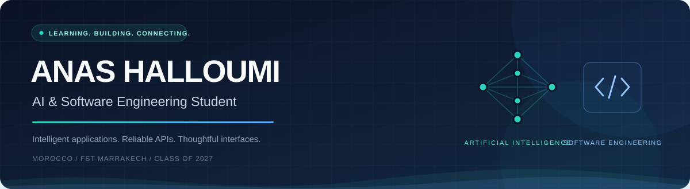

### Hi, I'm Anas 👋 — AI & Software Engineering Student

I build **intelligent applications** and the **software systems** behind them. 
From language models and data to backend APIs and web interfaces.

**Seeking a 6-month final-year internship (PFE) in AI & Software Engineering · January 2027**

Morocco 🇲🇦 · FST Marrakech, Cadi Ayyad University · Engineering degree expected in 2027

---

## 🧭 About me

I'm a final-year Computer Engineering student combining **artificial intelligence** with **software engineering**. I enjoy both working with models and building the applications that put them to use.

<table>
<tr>
<td width="50%" valign="top">

### 🧠 Artificial Intelligence

- LLM applications, AI agents and RAG.
- Connecting models to documents and structured data.
- Machine learning and deep learning foundations.
- Python, LangChain, scikit-learn and PyTorch.

</td>
<td width="50%" valign="top">

### 💻 Software Engineering

- Backend APIs, authentication and relational data.
- Full-stack applications and interactive interfaces.
- Java / Spring Boot, Python / FastAPI, PHP / Laravel.
- React, Next.js, TypeScript, Git and Docker.

</td>
</tr>
</table>

My internship experience spans industrial AI assistants, a web platform for the Belgian energy market, and internal business applications.

## 🚀 Featured projects

<table>
<tr>
<td width="50%" valign="top">

### ⚖️ [Mizan Legal AI](https://github.com/anasIRISI/MizanProject)

A legal document analysis platform built in a team of two: Gemini-powered analysis, JWT authentication, analysis history, multilingual interfaces and PDF reports.

**Spring Boot · React · MySQL · Gemini**

</td>
<td width="50%" valign="top">

### 🏭 [Industrial AI Assistant](https://github.com/anasIRISI/polydesign-ai-agent)

Developed during my Polydesign internship. An AI assistant combining read-only SQL tools and document retrieval to explore industrial data.

**Python · FastAPI · LangChain · RAG · MySQL · Redis**

</td>
</tr>
<tr>
<td width="50%" valign="top">

### ⚡ [Energy Platform](https://github.com/anasIRISI/energy-platform)

A web platform for the Belgian energy market, developed during my 3LM-Solutions internship, with related [frontend](https://github.com/anasIRISI/FRONT-END-energy-platform) and [AI](https://github.com/anasIRISI/AI-energy-platform) repositories.

**React · Spring Boot · Spring Security · PostgreSQL**

</td>
<td width="50%" valign="top">

### 🤖 [Agentix](https://github.com/anasIRISI/Agentix)

An application for configuring and testing Gemini-powered AI agents, with a playground, structured outputs, execution traces and version history.

**TypeScript · Next.js · Gemini · SQLite · Drizzle ORM**

</td>
</tr>
<tr>
<td width="50%" valign="top">

### ✉️ [agMailer](https://github.com/anasIRISI/agMailer)

A local internship application manager with email templates, attachments, Gmail OAuth and a persistent sending queue.

**Python · FastAPI · React · TypeScript · SQLite**

</td>
<td width="50%" valign="top">

### 🔀 [Atlas Flow](https://github.com/anasIRISI/Atlas-Flow)

A customized adaptation of FlowForge for visual workflow automation, with a node-based editor, a French interface and AI integrations.

**TypeScript · React · Node.js · Express · Gemini**

</td>
</tr>
</table>

## 🛠️ Technical toolkit

**Languages**

**Backend & frontend**

**Data & delivery**

**AI & machine learning**

LLMs · RAG · AI agents · LangChain · Prompt engineering · scikit-learn · PyTorch

## 💼 Internship experience

| Organization | Focus | Period |
| :--- | :--- | :--- |
| **Polydesign · Tangier, Morocco** | Industrial AI assistant: agents, read-only SQL tools, document RAG and FastAPI | Aug–Sep 2026 |
| **3LM-Solutions · Tunis, Tunisia** | AI and full-stack web development for the Belgian energy market | May–Jul 2026 |
| **Aptiv · Tangier, Morocco** | Internal business services application with Laravel and MySQL | Jul–Aug 2025 |

## 🎓 Certifications

- **Oracle** — Certified Generative AI Professional
- **Oracle** — Certified AI Foundations Associate
- **IBM** — RAG for Generative AI Applications
- **Meta** — React.js

## 📊 GitHub activity

---

### Let's build useful software with AI.

Open to a **6-month PFE internship starting January 2027** in **AI & Software Engineering**.

**[Portfolio](https://anas-halloumi.vercel.app/) · [anas1halloumi@gmail.com](mailto:anas1halloumi@gmail.com)**

Arabic: native · French: DELF B2 · English: B1

